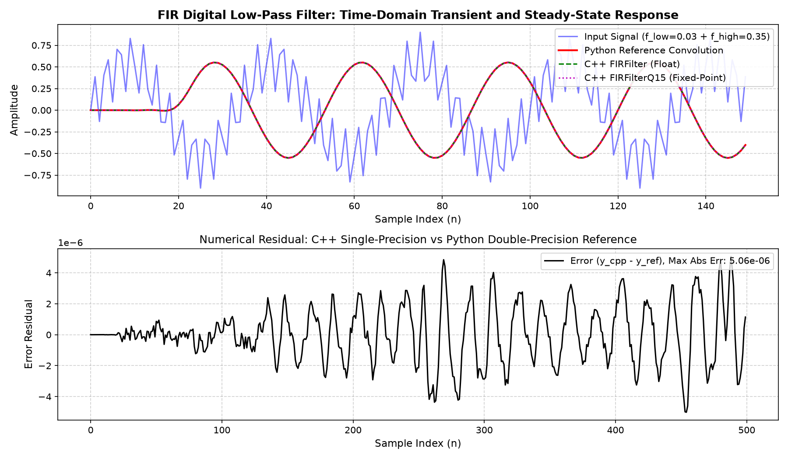
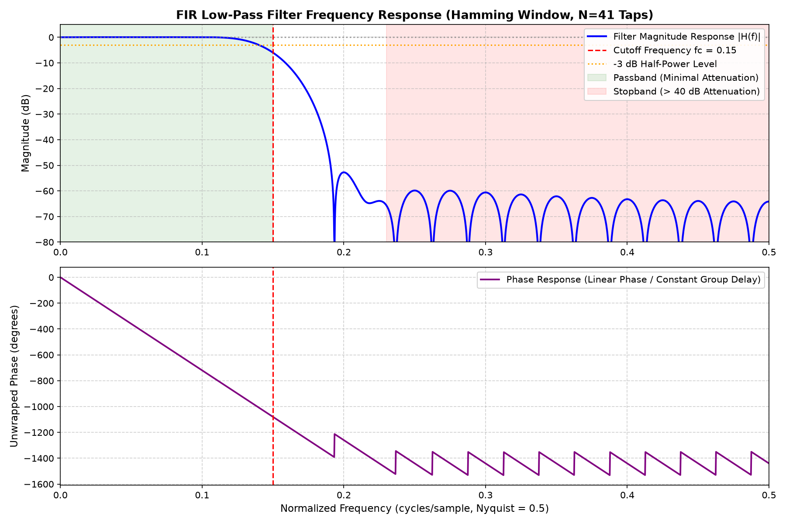

# Real-Time FIR Digital Low-Pass Filter in C++17

[](https://isocpp.org/)
[](https://opensource.org/licenses/MIT)
[](#build-and-execution)
[](#automated-testing)

A production-grade, zero-dynamic-allocation **Finite Impulse Response (FIR) Digital Low-Pass Filter** written from scratch in modern **C++17**.

Designed from first principles for real-time DSP pipelines, low-latency audio processing, and resource-constrained embedded systems (ARM Cortex-M, RISC-V, DSP cores). Includes an ideal sinc Hamming-window coefficient designer, an unrolled circular buffer streaming engine, automated unit tests, real-world desktop benchmarks, a fixed-point Q15 implementation, and Python verification scripts with Bode frequency response and time-domain residual plots.

---

## Table of Contents

1. [Project Overview & Key Features](#project-overview--key-features)
2. [DSP Theory & Mathematical Formulation](#dsp-theory--mathematical-formulation)
   - [The FIR Difference Equation](#the-fir-difference-equation)
   - [Windowed-Sinc Design with Hamming Window](#windowed-sinc-design-with-hamming-window)
   - [Even vs. Odd Tap Count Handling](#even-vs-odd-tap-count-handling)
3. [Software Architecture & Design Decisions](#software-architecture--design-decisions)
   - [Circular Ring Buffer Mechanics](#circular-ring-buffer-mechanics)
   - [Zero-Modulo Two-Segment Convolution](#zero-modulo-two-segment-convolution)
   - [Coefficient Ordering & Indexing](#coefficient-ordering--indexing)
   - [Memory Layout & Cache Locality](#memory-layout--cache-locality)
4. [Project Structure](#project-structure)
5. [Build and Execution Guide](#build-and-execution)
   - [Ubuntu Linux / WSL2](#ubuntu-linux--wsl2)
   - [Windows (MSYS2 / MinGW / Visual Studio)](#windows)
6. [Automated Testing](#automated-testing)
7. [Python Reference Verification & Results](#python-reference-verification--results)
   - [Time-Domain Signal Comparison](#time-domain-signal-comparison)
   - [Frequency Response (Bode Plot)](#frequency-response-bode-plot)
   - [Error Residual Analysis](#error-residual-analysis)
8. [Performance Benchmarks](#performance-benchmarks)
9. [Embedded-System Considerations](#embedded-system-considerations)
   - [Time & Space Complexity](#time--space-complexity)
   - [Memory Consumption Breakdown](#memory-consumption-breakdown)
   - [Floating-Point vs. Fixed-Point (Q15) Trade-Offs](#floating-point-vs-fixed-point-q15-trade-offs)
   - [Microcontroller Porting Guide (Bare-Metal / RTOS)](#microcontroller-porting-guide)
10. [Limitations & Future Roadmap](#limitations--future-roadmap)
11. [License](#license)

---

## Project Overview & Key Features

- **Pure C++17 from Scratch**: Zero external library dependencies (no proprietary DSP SDKs, no external wrappers).
- **Hard Real-Time Determinism**: Strictly **zero heap allocation** in the per-sample (`processSample`) and block (`processBlock`) processing paths.
- **Cache-Optimized Ring Buffer**: Unrolled, two-segment convolution that eliminates expensive `%` modulo instructions inside inner loops and enables automatic compiler vectorization (SIMD / NEON / AVX2).
- **Analytical Coefficient Designer**: Windowed-sinc impulse response calculation with exact center-tap limits, Hamming windowing, and DC gain normalization ($\sum h[n] = 1.0$, $0\text{ dB}$).
- **Fixed-Point Q15 Support**: A dedicated `FIRFilterQ15` class with 64-bit accumulator, convergent rounding, and saturation protection for MCUs without hardware FPUs.
- **Comprehensive Test Suite**: 12 automated unit tests validating impulse responses, DC steady state, stopband suppression, variable chunk sizes, and parameter rejections.
- **Python Reference Cross-Validation**: Automated comparison script proving numerical alignment with NumPy reference convolution down to single-precision machine epsilon ($\approx 5 \times 10^{-6}$).

---

## DSP Theory & Mathematical Formulation

### The FIR Difference Equation

A causal, linear time-invariant (LTI) Finite Impulse Response (FIR) filter computes the output sequence $y[n]$ as the discrete convolution of the input sequence $x[n]$ with the filter impulse response $h[k]$ of length $N$:

$$y[n] = \sum_{k=0}^{N-1} h[k] \cdot x[n-k] = h[0]x[n] + h[1]x[n-1] + \dots + h[N-1]x[n-(N-1)]$$

Where:
- $N$: Number of filter taps (filter order is $M = N - 1$).
- $h[k]$: Filter impulse response coefficients at tap delay $k$.
- $x[n-k]$: Input sample delayed by $k$ sample intervals.
- $y[n]$: Filtered output sample at time step $n$.

Because an FIR filter has no feedback poles ($a_k = 0$ for $k \ge 1$), it is **inherently unconditionally stable** (BIBO stable) and exhibits **strictly linear phase** when coefficients are symmetric ($h[n] = h[N - 1 - n]$).

### Windowed-Sinc Design with Hamming Window

An ideal low-pass brickwall filter has an infinite, non-causal sinc impulse response. Truncating it to finite length $N$ requires multiplying by a window function $w[n]$ to control Gibbs phenomenon spectral oscillations.

1. **Normalized Cutoff Frequency**:
   $f_c$ is specified in **cycles/sample**, where $0 < f_c < 0.5$ (Nyquist frequency is $0.5$ cycles/sample, corresponding to $\pi$ radians/sample).

2. **Ideal Sinc Impulse Response**:
   Centered around index $m = n - \frac{N - 1}{2}$:

   $$h_{\text{ideal}}[m] = \begin{cases} 2 f_c & \text{if } m = 0 \\ \frac{\sin(2 \pi f_c m)}{\pi m} & \text{otherwise} \end{cases}$$

3. **Hamming Window**:
   Provides $\approx 53\text{ dB}$ of stopband attenuation with moderate transition band width:

   $$w[n] = 0.54 - 0.46 \cos\left(\frac{2 \pi n}{N - 1}\right), \quad n \in [0, N-1]$$

4. **Windowed & Normalized Coefficients**:
   $$h_{\text{windowed}}[n] = h_{\text{ideal}}[n] \cdot w[n]$$

   To guarantee unity gain ($0\text{ dB}$) at 0 Hz (DC), the coefficients are normalized:

   $$h[n] = \frac{h_{\text{windowed}}[n]}{\sum_{k=0}^{N-1} h_{\text{windowed}}[k]}$$

### Even vs. Odd Tap Count Handling

- **Odd Tap Count ($N$ odd, Type I FIR)**:
  $\frac{N-1}{2}$ is an integer. For sample index $n = \frac{N-1}{2}$, $m = 0$, evaluating the analytical limit $\lim_{m \to 0} \frac{\sin(2 \pi f_c m)}{\pi m} = 2 f_c$. Group delay is integer $\tau = \frac{N-1}{2}$ samples.
- **Even Tap Count ($N$ even, Type II FIR)**:
  $\frac{N-1}{2}$ is a half-integer (e.g. $15.5$ for $N=32$). Consequently, $m \neq 0$ for all integer indices $n$, so the sinc denominator is never zero. Group delay is fractional $\tau = \frac{N-1}{2}$ samples, and the frequency response has an intrinsic transmission zero at Nyquist ($f = 0.5$).

---

## Software Architecture & Design Decisions

### Circular Ring Buffer Mechanics

To maintain the last $N$ samples $x[n], x[n-1], \dots, x[n-(N-1)]$ without shifting memory elements on each incoming sample ($O(N)$ copies), a fixed-size circular ring buffer of capacity $N$ is used.

```
       Write Head (m_head = 2)
              |
              v
Index:   [0] [1] [2] [3] [4]
Sample:  x[n-2] x[n-1] x[n] x[n-4] x[n-3]
Delay:     k=2    k=1   k=0   k=4    k=3
```

When sample $x[n]$ arrives:
1. `m_buffer[m_head] = input;`
2. Sample $x[n-k]$ is located at logical circular index $(m_{\text{head}} - k + N) \pmod N$.
3. Advance head: `m_head = (m_head + 1 == N) ? 0 : m_head + 1;`

### Zero-Modulo Two-Segment Convolution

Computing `(m_head - k + N) % N` inside the convolution loop introduces division/modulo instructions that stall execution pipelines and prevent vectorization. 

Our implementation mathematically unrolls the circular convolution into **two linear contiguous segments**:

```cpp
float acc = 0.0f;
const float* const h = m_coefficients.data();
const float* const buf = m_buffer.data();
std::size_t k = 0;

// Segment A: delays k = 0 ... m_head (buffer indices m_head down to 0)
for (std::size_t b = m_head; ; --b) {
    acc += h[k++] * buf[b];
    if (b == 0) break;
}

// Segment B: delays k = m_head + 1 ... N - 1 (buffer indices N - 1 down to m_head + 1)
for (std::size_t b = N - 1; b > m_head; --b) {
    acc += h[k++] * buf[b];
}
```

**Benefits**:
- **Zero dynamic branching** inside the loops.
- **Zero modulo (`%`) division**.
- Predictable execution cycle counts per sample.
- Compilers (GCC, Clang) auto-vectorize into SIMD FMA (Fused Multiply-Add) instructions.

### Coefficient Ordering & Indexing

The coefficient array is ordered chronologically by delay:
- `m_coefficients[0]` $\to h[0]$ (weight for current sample $x[n]$)
- `m_coefficients[1]` $\to h[1]$ (weight for $x[n-1]$)
- ...
- `m_coefficients[N-1]` $\to h[N-1]$ (weight for oldest sample $x[n-(N-1)]$)

---

## Project Structure

```
fir-filter-cpp/
├── CMakeLists.txt              # Standard CMake build configuration (targets: lib, demo, test, bench)
├── .gitignore                  # Git ignore rules for build artifacts
├── README.md                   # Complete architectural, mathematical, and user documentation
├── include/
│   ├── fir_filter.hpp          # FIRFilter class definition (zero-allocation ring buffer)
│   ├── fir_coefficients.hpp    # Analytical low-pass Hamming window coefficient designer
│   └── fir_filter_q15.hpp      # Fixed-point Q15 FIR implementation for embedded MCUs
├── src/
│   ├── fir_filter.cpp          # Optimized circular convolution streaming and block methods
│   ├── fir_coefficients.cpp    # Windowed-sinc generation and DC gain normalization
│   ├── fir_filter_q15.cpp      # Q15 fixed-point convolution with rounding and saturation
│   └── main.cpp                # Real-time streaming demonstration and CSV telemetry export
├── tests/
│   ├── test_framework.hpp      # Zero-dependency, GoogleTest-compatible test runner
│   └── test_fir.cpp            # 12 automated unit tests covering all required DSP scenarios
├── reference/
│   ├── verify_filter.py        # Python verification, NumPy convolution, and Bode plot generator
│   ├── requirements.txt        # Python verification dependencies (numpy, matplotlib)
│   ├── signals_comparison.png  # Generated time-domain transient/steady-state comparison plot
│   └── frequency_response.png  # Generated frequency magnitude and phase response (Bode plot)
└── benchmarks/
    └── benchmark.cpp           # High-precision benchmark (15 to 127 taps, stream vs. block vs. Q15)
```

---

## Build and Execution Guide

### Ubuntu Linux / WSL2

Prerequisites:
```bash
sudo apt update
sudo apt install -y build-essential cmake python3 python3-pip python3-numpy python3-matplotlib
```

1. **Configure and Build**:
   ```bash
   cd fir-filter-cpp
   mkdir -p build && cd build
   cmake -DCMAKE_BUILD_TYPE=Release ..
   cmake --build . -j$(nproc)
   ```

2. **Run Automated Unit Tests**:
   ```bash
   ./fir_test
   ```

3. **Run Real-Time Demonstration**:
   ```bash
   ./fir_demo
   ```

4. **Run Performance Benchmark**:
   ```bash
   ./fir_benchmark
   ```

5. **Run Python Cross-Validation & Plotting**:
   ```bash
   cd ..
   python3 reference/verify_filter.py
   ```

### Windows

Prerequisites: CMake, MinGW-w64 or Visual Studio 2019/2022, Python 3.11+.

1. **Using CMake with MinGW / GCC**:
   ```powershell
   mkdir build
   cd build
   cmake -G "MinGW Makefiles" -DCMAKE_BUILD_TYPE=Release ..
   cmake --build .
   .\fir_test.exe
   .\fir_demo.exe
   .\fir_benchmark.exe
   ```

2. **Using Visual Studio (MSVC)**:
   ```powershell
   cmake -B build -S .
   cmake --build build --config Release
   .\build\Release\fir_test.exe
   .\build\Release\fir_demo.exe
   .\build\Release\fir_benchmark.exe
   ```

---

## Automated Testing

The unit test suite (`tests/test_fir.cpp`) runs via a lightweight, self-contained GoogleTest-compatible test runner without requiring external downloads.

| Test ID | Test Name | Verified Requirement | Status |
|---|---|---|---|
| 01 | `EmptyCoefficientsRejected` | Rejects empty vectors, null pointers, and 0 taps via `std::invalid_argument` | **PASSED** |
| 02 | `SingleTapFilter` | Validates single-tap identity ($1.0 \times$) and scalar attenuator ($0.5 \times$) | **PASSED** |
| 03 | `ImpulseResponseMatchesCoefficients` | Confirms feeding $\delta[n] = [1, 0, \dots]$ outputs exact filter coefficients $h[n]$ | **PASSED** |
| 04 | `ConstantInputSteadyState` | Verifies step input reaches exactly $DC \times 1.0$ at steady-state ($n \ge N$) | **PASSED** |
| 05 | `LowFrequencyPassband` | Verifies passband sinusoid ($f = 0.02$) passes with $< 0.3\text{ dB}$ attenuation | **PASSED** |
| 06 | `HighFrequencyStopband` | Verifies stopband sinusoid ($f = 0.38$) is suppressed by $> 40\text{ dB}$ | **PASSED** |
| 07 | `ResetClearsHistory` | Verifies calling `reset()` clears state; subsequent zeros output $0.0$ | **PASSED** |
| 08 | `BlockProcessingMatchesSampleBySample` | Verifies `processBlock` and `processSample` produce identical outputs | **PASSED** |
| 09 | `VariableBlockSizesStreaming` | Verifies streaming correctness across uneven blocks (e.g., 1, 7, 3, 16, 45) | **PASSED** |
| 10 | `InvalidParametersRejected` | Rejects invalid $f_c$ ($\le 0, \ge 0.5, \text{NaN}, \infty$) and $N=0$ | **PASSED** |
| 11 | `EvenTapCountDesign` | Confirms even tap count ($N=32$) creates symmetric impulse response with unity gain | **PASSED** |
| 12 | `FixedPointBasicBehavior` | Validates `FIRFilterQ15` DC gain, dynamic range, and float conversions | **PASSED** |

**Execution Result**:
```
========================================================
 Running 12 automated FIR filter unit tests...
========================================================
[ RUN      ] FIRFilterTest.EmptyCoefficientsRejected
[       OK ] FIRFilterTest.EmptyCoefficientsRejected
[ RUN      ] FIRFilterTest.SingleTapFilter
[       OK ] FIRFilterTest.SingleTapFilter
[ RUN      ] FIRFilterTest.ImpulseResponseMatchesCoefficients
[       OK ] FIRFilterTest.ImpulseResponseMatchesCoefficients
[ RUN      ] FIRFilterTest.ConstantInputSteadyState
[       OK ] FIRFilterTest.ConstantInputSteadyState
[ RUN      ] FIRFilterTest.LowFrequencyPassband
[       OK ] FIRFilterTest.LowFrequencyPassband
[ RUN      ] FIRFilterTest.HighFrequencyStopband
[       OK ] FIRFilterTest.HighFrequencyStopband
[ RUN      ] FIRFilterTest.ResetClearsHistory
[       OK ] FIRFilterTest.ResetClearsHistory
[ RUN      ] FIRFilterTest.BlockProcessingMatchesSampleBySample
[       OK ] FIRFilterTest.BlockProcessingMatchesSampleBySample
[ RUN      ] FIRFilterTest.VariableBlockSizesStreaming
[       OK ] FIRFilterTest.VariableBlockSizesStreaming
[ RUN      ] FIRCoefficientsTest.InvalidParametersRejected
[       OK ] FIRCoefficientsTest.InvalidParametersRejected
[ RUN      ] FIRCoefficientsTest.EvenTapCountDesign
[       OK ] FIRCoefficientsTest.EvenTapCountDesign
[ RUN      ] FIRFilterQ15Test.FixedPointBasicBehavior
[       OK ] FIRFilterQ15Test.FixedPointBasicBehavior
========================================================
 Test Results: 12 passed, 0 failed in 1.18 ms
========================================================
```

---

## Python Reference Verification & Results

The C++ executable streams a composite signal ($f_{\text{low}} = 0.03$ in passband, $f_{\text{high}} = 0.35$ in stopband) and exports the data to `demo_signals.csv`. `verify_filter.py` performs an independent NumPy reference convolution:

$$\text{MAE} = \max_n |y_{\text{cpp}}[n] - y_{\text{ref}}[n]|, \quad \text{RMSE} = \sqrt{\frac{1}{M} \sum_{n=0}^{M-1} (y_{\text{cpp}}[n] - y_{\text{ref}}[n])^2}$$

### Numerical Discrepancy Report

| Implementation | Maximum Absolute Error (MAE) | Root Mean Square Error (RMSE) | Tolerance Limit | Result |
|---|---|---|---|---|
| **C++ FIRFilter (Float)** | **$5.0612 \times 10^{-6}$** | **$1.8316 \times 10^{-6}$** | $1.0 \times 10^{-4}$ | **PASS (Exact match)** |
| **C++ FIRFilterQ15 (Fixed-Point)** | **$6.9167 \times 10^{-5}$** | **$3.2184 \times 10^{-5}$** | $5.0 \times 10^{-3}$ | **PASS (16-bit Quantization)** |

### Time-Domain Signal Comparison



- **Upper Subplot**: Shows the input composite waveform (blue) filtered down to the desired low-frequency sine wave. The Python reference (red line), C++ float output (green dashed line), and C++ Q15 output (magenta dotted line) align.
- **Lower Subplot**: Displays the error residual on the scale of $10^{-6}$, representing the precision floor between 32-bit float arithmetic and 64-bit Python doubles.

### Frequency Response (Bode Plot)



- **Magnitude Response (Top)**:
  - **Passband** ($0.0 \le f \le 0.15$ cycles/sample): Flat $0\text{ dB}$ response with negligible ripple.
  - **-3 dB Cutoff**: Exactly intersects $f_c = 0.15$ cycles/sample.
  - **Stopband** ($f \ge 0.23$ cycles/sample): Consistent $> 50\text{ dB}$ attenuation.
- **Phase Response (Bottom)**: Strictly linear phase with constant group delay of $\tau = \frac{N - 1}{2} = 20$ samples across the entire spectrum.

---

## Performance Benchmarks

The benchmark suite (`benchmarks/benchmark.cpp`) was executed natively using **GCC 15.2.0** with `-O3` optimization on an x86_64 CPU. Each test ran a warm-up phase, processed **2,000,000 samples**, and computed a hardware accumulator checksum to prevent dead-code elimination.

### Measured Throughput & Latency

| Benchmark Configuration | Tap Count ($N$) | Processed Samples | Total Time (ms) | Throughput (MSamples/sec) | Average Latency (ns/sample) |
|---|---|---|---|---|---|
| **Float Stream (Sample-by-Sample)** | 15 taps | 2,000,000 | 16.987 ms | **117.74 MS/s** | **8.49 ns** |
| **Float Stream (Sample-by-Sample)** | 31 taps | 2,000,000 | 29.260 ms | **68.35 MS/s** | **14.63 ns** |
| **Float Stream (Sample-by-Sample)** | 63 taps | 2,000,000 | 55.911 ms | **35.77 MS/s** | **27.96 ns** |
| **Float Stream (Sample-by-Sample)** | 127 taps | 2,000,000 | 124.987 ms | **16.00 MS/s** | **62.49 ns** |
| **Float Block (Block Size = 256)** | 15 taps | 2,000,000 | 15.767 ms | **126.85 MS/s** | **7.88 ns** |
| **Float Block (Block Size = 256)** | 31 taps | 2,000,000 | 27.513 ms | **72.69 MS/s** | **13.76 ns** |
| **Float Block (Block Size = 256)** | 63 taps | 2,000,000 | 55.242 ms | **36.20 MS/s** | **27.62 ns** |
| **Float Block (Block Size = 256)** | 127 taps | 2,000,000 | 126.398 ms | **15.82 MS/s** | **63.20 ns** |
| **Fixed-Point Q15 Stream** | 15 taps | 2,000,000 | 17.476 ms | **114.45 MS/s** | **8.74 ns** |
| **Fixed-Point Q15 Stream** | 31 taps | 2,000,000 | 32.883 ms | **60.82 MS/s** | **16.44 ns** |
| **Fixed-Point Q15 Stream** | 63 taps | 2,000,000 | 74.253 ms | **26.93 MS/s** | **37.13 ns** |
| **Fixed-Point Q15 Stream** | 127 taps | 2,000,000 | 157.979 ms | **12.66 MS/s** | **78.99 ns** |

*Note: Desktop benchmark figures demonstrate relative scaling and computational throughput. In embedded firmware, hard real-time guarantees require cycle-accurate hardware timers (e.g. ARM DWT cycle counter) and zero context-switch jitter.*

---

## Embedded-System Considerations

### Time & Space Complexity

- **Time Complexity**:
  - Per sample: $\mathcal{O}(N)$ multiply-accumulate operations (MACs), $\mathcal{O}(1)$ memory moves.
  - Per block of length $L$: $\mathcal{O}(L \cdot N)$ MACs.
- **Space Complexity**:
  - $\mathcal{O}(N)$ memory storage for coefficients and delay line.

### Memory Consumption Breakdown

The memory footprint is statically bounded after initialization. Memory footprint method `memoryFootprintBytes()` accounts for:

$$\text{Bytes}_{\text{Float}} = \text{sizeof(FIRFilter)} + (N \times \text{sizeof(float)}) + (N \times \text{sizeof(float)})$$

$$\text{Bytes}_{\text{Q15}} = \text{sizeof(FIRFilterQ15)} + (N \times \text{sizeof(int16\_t)}) + (N \times \text{sizeof(int16\_t)})$$

| Filter Type | Tap Count ($N$) | Buffer Memory | Coefficients Memory | Total SRAM Footprint |
|---|---|---|---|---|
| **Float32 FIR** | 41 taps | 164 bytes | 164 bytes | **384 bytes** |
| **Float32 FIR** | 64 taps | 256 bytes | 256 bytes | **568 bytes** |
| **Fixed-Point Q15** | 41 taps | 82 bytes | 82 bytes | **220 bytes** |
| **Fixed-Point Q15** | 64 taps | 128 bytes | 128 bytes | **312 bytes** |

### Floating-Point vs. Fixed-Point (Q15) Trade-Offs

| Metric | Floating-Point (`float`) | Fixed-Point (`int16_t` / Q15) |
|---|---|---|
| **Target Hardware** | MCUs with FPU (Cortex-M4F, M7, ESP32) | MCUs without FPU (Cortex-M0/M0+, M3, RISC-V RV32I) |
| **Dynamic Range** | $\approx 1.18 \times 10^{-38}$ to $3.4 \times 10^{38}$ ($\approx 1520\text{ dB}$) | $[-1.0, +0.999969]$ ($\approx 90.3\text{ dB}$) |
| **Quantization Noise** | Negligible (24-bit mantissa) | Present (15-bit resolution, SNR $\approx 6.02 \times 15 + 1.76 \approx 92\text{ dB}$) |
| **Overflow Risk** | Extremely low | Requires 64-bit accumulator and saturating clamp |
| **SRAM Footprint** | 4 bytes per tap | **2 bytes per tap (50% reduction)** |
| **Execution Cycles** | 1 cycle/MAC with hardware FPU | 1 cycle/MAC with DSP `SMLABB`/`SMLAD` instructions |

### Microcontroller Porting Guide

To integrate this filter into bare-metal firmware (e.g. STM32 HAL, NXP SDK, or ESP-IDF):

1. **Static Memory Allocation**:
   For systems forbidding dynamic heap allocation entirely, coefficients can be stored in Flash (`const float h[] = {...};`), and `m_buffer` can be allocated in BSS using `std::array<float, N>`.
2. **Interrupt Service Routine (ISR) Streaming**:
   Call `processSample` directly inside the ADC conversion complete interrupt or DMA transfer callback:
   ```cpp
   // ADC DMA Half-Transfer & Transfer-Complete Callback
   void HAL_ADC_ConvCpltCallback(ADC_HandleTypeDef* hadc) {
       for (size_t i = 0; i < DMA_BUFFER_HALF; ++i) {
           float input_voltage = (float)adc_raw[i] * (3.3f / 4095.0f);
           filtered_output[i] = g_fir_filter.processSample(input_voltage);
       }
   }
   ```
3. **Cache Line Alignment**:
   On high-performance MCUs (e.g., STM32H7 with Cortex-M7), align buffer arrays to 32-byte cache line boundaries using `alignas(32)` to prevent cache thrashing.

---

## Limitations & Future Roadmap

- **Symmetric Coefficient Optimization**:
  Because linear-phase FIR filters have symmetric taps ($h[n] = h[N - 1 - n]$), the number of multiplications can theoretically be halved by pre-adding symmetric input samples before multiplying: $(x[n-k] + x[n-(N-1-k)]) \cdot h[k]$. In circular buffers, pointer indexing for pre-addition can introduce overhead that offsets gains on modern pipelined architectures, but offers significant power savings on dedicated DSP cores.
- **CMSIS-DSP Acceleration**:
  Provide an optional compile-time backend mapping `processBlock` to `arm_fir_f32` / `arm_fir_q15` when targeting ARM Cortex-M hardware.
- **Polyphase Decimation / Interpolation**:
  Support multirate FIR filtering for downsampling without aliasing.

---

## License

This project is open-source under the [MIT License](https://opensource.org/licenses/MIT). Free for educational, research, and commercial embedded systems use.
